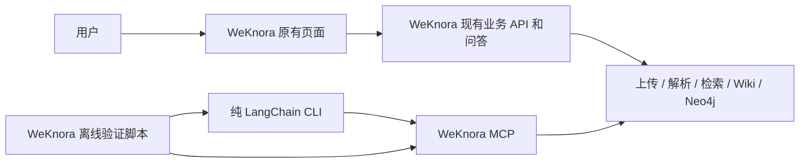

# WeKnora MCP 与纯 Agent 纠偏修改方案

> **2026-10-14 执行交接：** 用户已要求把剩余工作交给其他模型。当前进度、已提交裁剪、未完成回归及真实 Wiki/Neo4j 资料以 [剩余工作交接](remaining-work-handoff-2026-10-14.md) 为准。下文审查基线保留为历史，不代表 Agent Web 或所有旧问题仍存在。

> 供执行模型：按任务逐项实施、验证和交付；有对应技能时使用 executing-plans。此文件覆盖旧方案中与本次边界冲突的要求，不把已经修复的旧缺陷重新实施一遍。

**目标：** WeKnora 提供完整可用的文档、问答、RAG、Wiki、实体图谱与 MCP；WeKnora-Agent 仅验证标准 LangChain 调用 MCP。

**架构：** 页面和日常问答继续使用 WeKnora 现有实现。Agent 恢复为模型配置、MCP 连接、create_agent 和 CLI；部署及评估在 WeKnora 验证目录。

**技术栈：** 现有 Go/Gin、mcp-go、Vue、存储／队列与 Neo4j；Python 3.12+、LangChain、langchain-mcp-adapters、选定模型 provider。

**用户已明确确认：** “先用 WeKnora 现有问答，Agent 仅验证 MCP”。因此不增加 Go→Python 问答适配层，不搭建 Agent Web 宿主，不把 WeKnora 页面改为运行 LangChain。

审查基线：2026-10-14，WeKnora `d68b0f47c`；WeKnora-Agent `7828b6f`。本轮只核查和写方案，未修改业务代码、部署或评估数据。

## 1. 当前实现为什么仍不符合预期

### 1.1 Agent 的职责重新扩张

`WeKnora-Agent/webapp.py` 新增 214 行生产代码，承担 Starlette HTTP、SSE、静态页面、邮箱密码登录、JWT 替换、401 重跑和全局 Agent／身份缓存。`requirements.txt` 又直接引入 Starlette、sse-starlette、Uvicorn。

这与“标准 LangChain/LangGraph + MCP 配置，其他业务都在 WeKnora”的边界冲突。叫“演示壳”不改变这些实际职责。自动登录意味着 Agent 依赖 WeKnora 身份 REST API，而不是只接收调用方已准备好的身份并调用 MCP。

它也没有兑现统一业务页面：`web/index.html` 只做聊天，文档上传、资料管理、Wiki／图谱仍在另一套 WeKnora UI。用户实际要维护两套入口，而不是一个完整的知识使用流程。

额外问题：ANSWER_TIMEOUT=180 只是常量，stream_answer 没有 asyncio.timeout 包裹；全局 state 持有固定演示账户的 JWT，不适合作为主产品多用户链路。这些应随演示应用退出，而不是继续在 Agent 内修成身份／会话平台。

### 1.2 旧缺陷已有修复，但核心验收仍未闭环

不能继续用昨日的全部 R1～R14 作为当前未修复清单。最新代码已增加写入身份门禁、修正 Wiki ORM 字段、兼容来源数据类型、补幂等 hash 校验、CORS、回执错误及清理调度。其修复仍需相应回归测试，但这些工作应保留。

| 检查 | 当前事实 |
| --- | --- |
| Agent 单仓库测试 | 12 passed、1 failed；失败是 requirements.txt 中 uvicorn 违反结构测试 |
| 离线验证脚本测试 | 10 passed |
| pip check | 无依赖冲突；不代表架构合规 |
| 真实 KB 状态 | documents=10、chunks=13、counts_known=true；文档列表 total=10，昨日计数错误已修复 |
| 原始评估轨迹 | 当前十二题均保存 raw_events，昨日“没有轨迹”的问题已修复 |
| 原始 search 输出 | artifact.structured_content.results 已含 knowledge_id、knowledge_base_id、chunk_id、content |
| Wiki／实体图谱实测 | 交付报告仍承认正向流程未完成；已有 smoke 图谱结果为 GRAPH_EXTRACTION_NOT_CONFIGURED |
| 模型评估实际工具 | 主要为 search/grep/read；未调用 query_knowledge_graph 或 wiki_read_page |
| 策略比较 | 十二条记录均无 strategy；没有单次检索基线 |
| 人工复核 | 0/12，不能宣称最终准确性通过 |

本次没有重跑全量 Go 测试，也没有为证明问题而创建／删除真实业务资料。跨仓库合并 pytest 曾因同名 tests 包收集失败，已拆开运行；该命令使用问题不列作业务缺陷。

### 1.3 评估仍存在确定的逻辑错误

当前 run_eval 已改为查看工具文本，这是进步，但仍忽略原始 artifact 的结构化来源。它把 required_evidence 的前 20 个字与本地全部语料匹配，反推“找到了哪篇文档”。

已复现：一次无 ID 的工具返回相同片段，本地 doc01 和 doc02 恰好都有该片段，函数就返回两篇均找到。标注信息参与了预测来源归属，不能证明实际召回。

score_eval 的无答案分支依然根据“没有 hit_evidence 且没有 tool_error”算诚实。无答案题 required_evidence 为空，因此即便最终答案明确虚构预算，也能得到诚实 1/1；本次已用临时反例复现，没有修改保存的运行记录。

## 2. 目标边界和默认使用流程

### 2.1 用户只有一个业务入口



页面流程：登录 WeKnora → 选择工作空间和知识库 → 上传文档 → 查看处理状态 → 检索／现有问答 → 查看原文来源 → 浏览 Wiki／相关关系。

LangChain 流程：调用者提供模型和 MCP 配置 → SDK 发现工具 → 标准 Agent 调用工具 → 输出答案／原始消息。它独立证明 MCP 可被外部标准 Agent 使用，不接管 WeKnora 日常问答。

### 2.2 Agent 目标目录

```text
WeKnora-Agent/
  main.py
  agent.py
  mcp.json
  requirements.txt
  requirements-dev.txt
  .env.example
  README.md
  tests/
  docs/
```

main.py 负责 env／CLI／模型初始化／原生运行；agent.py 负责 SDK get_tools、只读名单、短提示词和 create_agent。允许少量原生回调／运行参数透传，禁止自研模型包装器、工具响应加工和运行时。

生产目录不保留 webapp.py、web、登录、JWT 自动刷新、全局用户身份缓存、上传中转或另一套问答 API。MCP SDK 自身传递引入的服务器依赖允许存在；禁止的是项目直接依赖并运行新的 Web 应用，不为了“pip 包里不能出现 Uvicorn”复制 SDK。

### 2.3 WeKnora 的职责

| 能力 | 所在位置 |
| --- | --- |
| 登录、用户、空间、知识范围 | WeKnora 现有身份／权限服务 |
| 文档上传、解析、索引和生成 | WeKnora 原有业务链路 |
| 日常 AI 问答、聊天与流式展示 | WeKnora 现有页面和后端 |
| RAG／原文／Wiki／实体关系的外部调用 | WeKnora MCP 工具 |
| 来源、错误、状态与截断 | WeKnora 服务输出，客户端不猜映射 |
| MCP 导入、回执和清理 | 现有 WeKnora 服务模块；不进入 Agent |
| 部署、语料、协议自检、评分 | WeKnora/examples/mcp-validation |

首期不裁剪 WeKnora 的现有业务功能，不重建前端，不新增另一套身份服务。MCP 导入工具已实现则保留并验证；日常用户上传仍走现有页面，不强迫用户从 CLI 上传。

## 3. 收敛方式选择

| 方式 | 范围与代价 | 结论 |
| --- | --- | --- |
| 原地收敛最新代码 | 退出 Agent 演示应用；保留最新服务修复；补正向测试与评分 | 推荐，变动最小，保留已完成工作 |
| 从纯 Agent 提交提取客户端文件 | 参考 1d68ce5 恢复客户端，再逐项保留后来正确的测试／告警 | 可行，但容易漏掉有用修复；不能整仓库 reset |

采用第一种。不要回滚 WeKnora 的 d68b0f47c，也不要把原有业务全部搬进一个新 MCP 项目。

## 4. 执行任务与验收

每项修复先写对应失败用例、确认失败，再做最小修改、跑相关检查。保留已有环境秘密及未提交文件；每个仓库只处理明确路径，不使用 git reset --hard、git clean -fd 或 git add .。

### 任务 A：退出 Agent Web／身份职责（第一优先级）

**处理文件：** WeKnora-Agent/webapp.py、web/index.html、requirements.txt、README.md、.env.example；main.py／agent.py 仅做必要的标准框架整理。

- [ ] 保存 7828b6f 提交和本地未提交变化的恢复记录；归档应在项目外，不能保留为 legacy_web 默认目录。
- [ ] 确认演示服务的具体进程／启动方式，只停止它，不能停止 WeKnora UI 或知识服务。
- [ ] 移除 webapp.py 与 web；移除 runtime requirements 中项目直接声明的 Starlette、sse-starlette、Uvicorn。
- [ ] 从 Agent 配置示例和运行说明退出 WEKNORA_DEMO_EMAIL/PASSWORD、Web 端口和自动登录说明；不要把真实 .env 的内容输出到日志或交付。
- [ ] main.py 继续接收外部提供的 JWT；过期时明确非零退出，不在客户端登录或刷新。
- [ ] 继续保留 SDK get_tools、create_agent、十三项只读筛选和缺失告警；不要让模型获得 import_document_file／get_upload_status／嵌套 ask。
- [ ] README 只描述 CLI／库入口，业务页面明确指向 WeKnora 现有问答。

验收命令：

```powershell
Set-Location E:\GoLandCode\WeKnora-Agent
.\.venv\Scripts\python.exe -m pytest tests -q
.\.venv\Scripts\python.exe -m pip check
.\.venv\Scripts\python.exe main.py --help
Get-ChildItem -File -Filter *.py | Select-Object Name
rg -n 'Starlette|EventSourceResponse|login_for_token|WEKNORA_DEMO|uvicorn|backend\.app' main.py agent.py requirements.txt .env.example README.md
```

预期：所有测试通过；生产 Python 文件只有 main.py／agent.py；最后 rg 无匹配（通常退出 1，属于此项预期）。现有结构测试不得删除或放宽以接受新应用。

结构回归测试加入 tests/test_project_boundary.py：

```python
from pathlib import Path

def test_production_entrypoints_stay_minimal():
    root = Path(__file__).resolve().parents[1]
    assert {p.name for p in root.glob("*.py")} == {"main.py", "agent.py"}
    assert not (root / "web").exists()
    direct = (root / "requirements.txt").read_text(encoding="utf-8").splitlines()
    prohibited = {"starlette", "sse-starlette", "uvicorn", "fastapi"}
    packages = {line.strip().split("==", 1)[0].lower()
                for line in direct if line.strip() and not line.lstrip().startswith("#")}
    assert not packages & prohibited
```

### 任务 B：统一业务使用入口，保留 WeKnora 原问答

**复用文件：** WeKnora/frontend/src/views/knowledge/KnowledgeBase.vue、wiki/WikiBrowser.vue、views/chat/index.vue、views/chat/components/tool-results/GraphQueryResults.vue、现有上传／来源组件。

- [ ] 业务默认入口只保留 WeKnora UI；说明文档不再引导启动 18100 的 Agent 聊天页。
- [ ] 按用户操作走一遍上传、状态、资料检索、现有 AI 问答、原文引用、Wiki 页面和图谱结果；记录各步对应现有页面／接口。
- [ ] 只修实际缺失的来源跳转、状态／错误／截断展示，不重做布局和登录，不增加新的 Chat API。
- [ ] Wiki 页链接图标为“Wiki 页面关系”；Neo4j 实体图谱标为“实体关系”。现有知识页 graph tab 是 Wiki 链接图，不能以它代替实体关系验收。
- [ ] 若现有实体图谱入口隐藏或不易发现，在 WeKnora 原有结果／知识页加最小入口，复用 GraphQueryResults；不创建 Agent 侧图谱页面。
- [ ] 如果前端源码修改，构建当前源码的 WeKnora UI 镜像；release UI 镜像不会自动包含本地改动。

验收：用户只需要访问 WeKnora 页面，能够完成全部核心知识操作。页面回答明确来自 WeKnora 原问答；LangChain 验证在 CLI 独立执行，不虚构两者已经接入。

前端有变更时运行 `npm run type-check`、`npm run build` 和对应组件测试，无变更不为完成任务而修改前端。

### 任务 C：证明 MCP 真正可独立使用

**修改／测试：** WeKnora/examples/mcp-validation/scripts/mcp_smoke.py、该目录 tests；只在协议验证失败时增量改 internal/mcpserver 和 middleware。

- [ ] 直接用原生 MCP SDK 的 Streamable HTTP 发现十三项只读工具并检查 inputSchema；不通过 Agent Web API。
- [ ] 工具发现及调用使用四个标准头：端点 token、用户 JWT、空间 ID、选定 KB IDs。
- [ ] 用实际用户身份跑成功、缺 JWT、错误空间、选 A 读取 B、共享只读／可写 KB、非创建者写入、端点禁用场景。
- [ ] 新增 requireKBWriteOwnership 的回归矩阵，确认用户模式与机器模式分开处理，共享授权没有被误当成同空间管理权限或误拒所有共享编辑者。
- [ ] 共享写入以原 REST 的角色／创建者门禁与实际共享权限共同决定，逐角色比较 REST 与 MCP 的结果；若 REST 不允许某成员写入，MCP 也必须拒绝。本方案不另改产品权限政策。
- [ ] 错误必须保留 HTTP／MCP 状态和 structured error code，不靠字符串里出现 401 判断并重新登录。
- [ ] 正向调用与负向错误测试分开。GRAPH_EXTRACTION_NOT_CONFIGURED 的正确拒绝不算“图谱已跑通”。

源文件优先核对：internal/mcpserver/scope.go、tools_import.go、upload_transport.go；internal/middleware/mcp_endpoint_auth.go；internal/router/router.go。

验收：标准 SDK 能独立完成 tools/list／tools/call，知识权限由 WeKnora 校验，客户端没有身份 REST 登录依赖。

### 任务 D：让 Wiki 和 Neo4j 真正成为已验证的核心能力

**使用／修改：** WeKnora 服务的 Wiki／graph 配置与现有管线；internal/mcpserver/tools_wiki.go、tools_graph.go；internal/types/wiki_page.go；Neo4j repository；必要的测试和服务自检脚本。

- [ ] 创建隔离测试 KB，启用 keyword/vector、Wiki、extract_config.enabled 以及实际实体／关系类型。只调整配置不能证明已生成。
- [ ] 向测试 KB 导入至少两份资料：一份记录“张三负责项目 A”，另一份记录“项目 A 依赖服务 B”；分别保留真实 knowledge/chunk IDs。
- [ ] 等待实际解析／生成状态；状态未知、失败或超时要记录，不通过固定 sleep 推断就绪。
- [ ] Wiki 必须真实走通 index → search → read_page → list_pages → wiki_graph；页面正文和至少两条原文来源可回读。
- [ ] 实体图谱必须真实走通抽取 → Neo4j 写入 → query_knowledge_graph → 逐关系原文回读。确认两条关系分别引用自己的文档／chunk。
- [ ] 同一关系在两次不同 chunk 抽取中出现时，Neo4j 能合并来源；旧关系、跨文档同名实体、方向、cap 截断和部分故障分别验证。
- [ ] 来源在 MCP payload 中自包含，客户端只消费它；不能依据标题或标注库猜关系出处。

剩余来源语义需补测试：

1. 当前 graphEdgeRefs 将多个 chunk ID 配一个 quote。某个 chunk 有原文，其他未读时，不能让整个来源集合都视为 verified；按来源／chunk 分条或显式标部分未核验。
2. Wiki legacy source refs 目前只解析 ID 并填 page.KnowledgeBaseID、unknown。维持 unknown 是诚实的，但需要实际授权读取来源后才能证明 quote 和真正资源 KB；不能把解析 ID 当作验证完成。
3. 当前 status 已实际查询计数；processing 查询失败／chunk service 缺失时仍需防止 counts_known=true。每项统计的 known 条件都应独立确认，未知不能显示成“没有处理中任务”。

最小修复方式：复用现有 SourceRefV2，不再另建 E 编号；来源读不到则保留 unverified_source／unknown；统计查询失败则 CountsKnown=false 并说明具体缺项，保持已有成功路径。

验收：真实 Wiki 和实体图谱分别保存正向结果、真实来源和原文片段；配置关闭、模拟 fixture 和错误路径均不能替代正向结果。

### 任务 E：巩固已修复的服务稳定性，不重复造业务平台

**保留并回归：** upload_staging、upload_repository、upload_sweep、tools_import、container 注册及已有 migrations。

- [ ] 相同 key／相同 bytes 重放；相同 key／不同 bytes 冲突；并发首次上传发生唯一键竞争时回查并比较原回执。
- [ ] 导入回执 Complete 失败返回已创建知识 ID，不能返回完整成功；验证响应丢失后可恢复，不重复创建文档。
- [ ] 清理和 import 领取之间做并发测试：过期候选被查询后、文件删除前如果被重新领取，不能删掉活跃导入的 payload。修复应以原子状态／租约领取清理资格，或领取操作拒绝过期并证明时间边界。
- [ ] 清理文件失败必须可观察、可重试，不能 removeAllQuiet 后仍计删除成功；不能在无法枚举待清理记录时继续删除其回执。
- [ ] 数据库删除回执不得影响活跃导入租约；已过期 importing 的字节保留／回收策略有明确期限和可恢复流程。
- [ ] 验证 CORS 两个新增头、状态／scope 错误、Scheduler 启停，复用现有测试，不加 Agent 侧数据库或队列。

这部分只补真实恢复／并发缺口。已实现的上传回执和清理保留在 WeKnora，不移动进 Agent，也不为“减少文件”直接删除迁移和数据。

### 任务 F：重建基于真实结构化来源的评估

**修改文件：** WeKnora/examples/mcp-validation/scripts/run_eval.py、recompute_found.py、score_eval.py、seed_review.py；**新增：** scripts/evidence_records.py、tests/test_evidence_records.py。

依赖方向固定：运行 → 采集实际 MCP 结果 → 生成 retrieved evidence records → 与标注比较。标注语料不参与推断模型“找到了什么”。

- [ ] 从 raw_events 的 ToolMessage.status 和 artifact.structured_content 读取来源；error 结果、非内容发现／状态工具不计“读到原文”。
- [ ] search 的确切 schema 已存在：structured_content.results 每行有 knowledge_id、knowledge_base_id、chunk_id、content。直接读取，不使用 UUID 全局正则或前 20 字匹配猜来源。
- [ ] read_document、Wiki、graph 各按其真实 schema 抽取；source_refs 只有 ID 无 quote 时记录“发现出处”，不计“已读取支持证据”。
- [ ] 保留两类字段：discovered_documents 与 read_evidence；问题需要找齐的是实际相关文档，证据完整性另算。不能把枚举全部文档自动算检索成功。
- [ ] 统一使用 manifest 的真实 knowledge ID 映射；没有 ID 或无法归属的文本记 unattributed，不能在本地全部语料中找到同句就计入所有文档。
- [ ] required_evidence 改为带逻辑文档及锚点的标注项；比较时要求正确 knowledge ID／必要 chunk、完整证据内容匹配。前缀相同但后半句不同不能算命中。
- [ ] 增量增加 evidence_annotations_v2，每项为 logical_doc_id、quote、可选 chunk_ids；保留旧 required_evidence 供历史记录读取。真实 ID 从固定版本 manifest 映射，chunk 锚点由原文读取建立；跨 chunk 的连续证据只允许在同一文档按顺序拼接。
- [ ] 事实等价／支持强弱由人工核验，字符串匹配只能作为可解释的辅助结果；不以 LLM judge 替代初期领域复核。
- [ ] 同一原始轨迹重新评分不需要重新调用模型；先修评分、对现有十二条记录重算，再决定哪些缺失场景必须新增运行。

输出的 evidence record：

```json
{
  "tool_call_id": "真实消息中的调用 ID",
  "tool_name": "search_knowledge",
  "knowledge_base_id": "实际 KB UUID",
  "knowledge_id": "实际文档 ID",
  "chunk_id": "实际 chunk ID",
  "text": "工具返回的原文",
  "read_state": "returned_text"
}
```

以下是 search 输出的最小抽取函数，放在离线 evidence_records.py，不能放进 Agent：

```python
def search_passages(message):
    if message.get("type") != "tool" or message.get("status") != "success":
        return []
    if message.get("name") not in {"search_knowledge", "grep_chunks"}:
        return []
    body = (message.get("artifact") or {}).get("structured_content")
    if not isinstance(body, dict):
        return []
    records = []
    for row in body.get("results", []):
        if not isinstance(row, dict):
            continue
        if not all(row.get(k) for k in ("knowledge_id", "knowledge_base_id", "chunk_id", "content")):
            continue
        records.append({"tool_call_id": message.get("tool_call_id"),
                        "tool_name": message["name"],
                        "knowledge_base_id": row["knowledge_base_id"],
                        "knowledge_id": row["knowledge_id"],
                        "chunk_id": row["chunk_id"],
                        "text": row["content"], "read_state": "returned_text"})
    return records
```

这只处理已核对的 search/grep 路径；其他工具写各自明确的 schema 解析函数，不用一个递归正则把任意元数据当成证据。

必须先写的回归用例：

在 `examples/mcp-validation/tests/conftest.py` 统一加入本目录脚本路径，避免误导入 WeKnora 根目录的同名 scripts 包：

```python
import sys
from pathlib import Path

sys.path.insert(0, str(Path(__file__).resolve().parents[1] / "scripts"))
```

`tests/test_evidence_records.py`：

```python
from evidence_records import search_passages

def test_same_text_does_not_invent_a_second_document():
    message = {"type": "tool", "name": "search_knowledge", "status": "success",
               "tool_call_id": "call-1", "artifact": {"structured_content": {"results": [
                   {"knowledge_id": "real-d1", "knowledge_base_id": "kb-a",
                    "chunk_id": "c1", "content": "两篇文档可能有相同句子"}]}}}
    passages = search_passages(message)
    assert {p["knowledge_id"] for p in passages} == {"real-d1"}

def test_error_payload_is_not_retrieved_evidence():
    message = {"type": "tool", "name": "search_knowledge", "status": "error",
               "artifact": {"structured_content": {"results": [
                   {"knowledge_id": "d1", "knowledge_base_id": "kb",
                    "chunk_id": "c1", "content": "错误内容不算原文"}]}}}
    assert search_passages(message) == []
```

追加断言：最终答案伪造 doc02 不提高发现率；Wiki 仅列 ID 不提高证据读到率；原文返回未包含完整标注片段不提高完整性；artifact 有真实来源而纯文本没有 ID 时仍正确统计。

### 任务 G：补比较策略、错误分类和人工准确性

**修改文件：** run_eval.py、score_eval.py、seed_review.py、eval/questions／reports；Agent main.py 仅允许短小的标准模型初始化／运行配置复用。

- [ ] 增加 --strategy baseline|agent|both，单次 hybrid top-10 + 一次模型资料问答作为基线；Agent 策略使用标准自主工具调用。
- [ ] 两策略使用同样模型、用户、KB、题库、temperature=0；不能用一个策略 120 秒模型超时、另一个 60 秒却不记录差异。
- [ ] CLI 与评估复用 build_agent 和同一模型初始化配置；总超时 120 秒覆盖模型初始化后的工具发现、运行及工具调用，model timeout 60、recursion_limit 20。
- [ ] 记录 run_status=success|timeout|tool_error|model_error|config_error、strategy、配置指纹、运行版本；失败题保留分母，不把 [ERROR] 字符串当唯一失败分类。
- [ ] 捕获原生框架 messages／事件，错误结束仍尽量保存已发生的工具事件；不新增生产工具包装或自研预算层。
- [ ] 无答案题未人工复核，refusal_status=not_evaluated；不自动标“诚实通过”。
- [ ] 人工复核字段加入 refusal_supported、fabricated_content、fabricated_citation，均允许 null。只有 reviewed=true、无工具／模型失败且确认未编造才可计通过。
- [ ] 对十二题每条事实与来源复核，写出指标分子／分母及遗漏／冲突。部分复核不能显示完整验收通过。
- [ ] 题库补单独边界组：多页原文、超过 top-K、相同片段重复文档、来源未知、知识冲突、Wiki／graph 未生成、越权、超时与空答案。

统一复核判断函数（离线 score_eval.py）：

```python
def refusal_verdict(run, human_review):
    if run.get("run_status") != "success" or run.get("tool_error"):
        return "run_failed"
    keys = ("refusal_supported", "fabricated_content", "fabricated_citation")
    if not human_review.get("reviewed") or any(human_review.get(k) is None for k in keys):
        return "not_evaluated"
    if (human_review["refusal_supported"] and not human_review["fabricated_content"]
            and not human_review["fabricated_citation"]):
        return "passed"
    return "failed"
```

对应失败用例：

```python
from score_eval import refusal_verdict

def test_unreviewed_fabricated_answer_does_not_pass():
    run = {"run_status": "success", "tool_error": False,
           "final_answer": "预算为100亿元，引用不存在的来源。"}
    assert refusal_verdict(run, {"reviewed": False}) == "not_evaluated"

def test_reviewed_fabrication_fails():
    run = {"run_status": "success", "tool_error": False}
    review = {"reviewed": True, "refusal_supported": False,
              "fabricated_content": True, "fabricated_citation": True}
    assert refusal_verdict(run, review) == "failed"
```

首轮验收标准：

| 指标 | 计算依据 | 门槛 |
| --- | --- | --- |
| 文档 recall | 实际内容工具返回的真实文档 ID 与相关文档标注比较 | 可回答题宏平均 ≥90% |
| 找齐率 | 每题全部标注相关文档均找到 | 至少 8/10；同时展示未找齐题 |
| 必需证据 recall | 正确文档／chunk 的工具原文覆盖完整标注证据 | 宏平均 ≥90% |
| 事实准确率 | 人工正确事实 / 输出可核验事实 | ≥95% |
| 事实完整率 | 人工覆盖必要事实 / 标注必要事实 | ≥90% |
| 引用支持率 | 原文支持引用 / 全部引用 | ≥95%；unknown 不计支持 |
| 无答案 | 明确证据不足、不编造事实或来源，人工已确认 | 2/2 |
| 权限 | 未授权资料／来源无泄漏 | 所有边界用例通过 |

这些门槛只用于小型原型，不保证任意真实知识库的全量召回。基线与 Agent 分别报告；不因为统计达到 100% 就跳过来源与人工核验。

### 任务 H：统一文档和交付口径

**修改文件：** 两仓库 README、WeKnora-Agent/docs/implementation-plan.md、examples/mcp-validation/eval/reports/delivery.md／report.md。

- [ ] 文档首屏明确“业务页面＝WeKnora 现有问答；LangChain＝MCP 验证”，不再声称 Agent 无登录同时介绍自动登录。
- [ ] 更新真实目录和命令，退出 Agent Web 启动方式；不要把不存在／尚未实现的 CLI 选项写成可运行命令。
- [ ] 更新历史 R1～R14 修复状态，但分别记录“源码已修复、回归已验证、真实链路已验证”。
- [ ] Wiki／Neo4j 没有正向结果就不能勾核心能力完成；0/12 人工复核就不能勾答案准确性完成。
- [ ] delivery.md 中旧 0.8／新 1.0 的重复指标改为一份最新且说明统计定义的表；旧报告标历史版本，不混作当前验收。
- [ ] 留下原始工具结果、评估脚本版本、服务镜像版本和限制；不记录密码、JWT 或 endpoint token。

## 5. 检查命令与运行顺序

### 5.1 结构恢复与脚本测试

```powershell
Set-Location E:\GoLandCode\WeKnora-Agent
.\.venv\Scripts\python.exe -m pytest tests -q
.\.venv\Scripts\python.exe -m pip check
.\.venv\Scripts\python.exe main.py --help

Set-Location E:\GoLandCode\WeKnora
& E:\GoLandCode\WeKnora-Agent\.venv\Scripts\python.exe -m pytest examples/mcp-validation/tests -q
```

分别从各自 cwd 执行，不混合两个同名 tests 包。测试结构约束失败时修目录和依赖，不能删断言获得全绿。

### 5.2 WeKnora 回归和镜像生效

```powershell
Set-Location E:\GoLandCode\WeKnora\examples\mcp-validation
$composeArgs = @('-p', 'weknora-agent-prototype', '-f', 'deploy/compose.prototype.yml', '--env-file', 'deploy/.env.prototype')
docker compose @composeArgs config --quiet
docker compose @composeArgs run --rm --build -e 'WEKNORA_CHECK_PKGS=./internal/mcpserver ./internal/middleware ./internal/router ./internal/types ./internal/application/repository ./internal/application/repository/retriever/neo4j ./internal/application/service ./internal/agent/tools' weknora-check
```

明确包含 Wiki repository 创建／更新回归；在有 CGO/SQLite 的 Linux 环境执行。无关沙箱依赖失败应单独记录原因，不能跳过 Wiki／图谱／MCP 测试后报告全量通过。

源码确有服务修改时才 build weknora 并 up 原服务。只改离线评分不需要重建业务镜像。不得 down -v、清空现有数据库或重建正式知识库。

### 5.3 MCP／真实模型／评估

先正向服务自检，后单个标准 Agent CLI 问答，最后离线比较：

```powershell
Set-Location E:\GoLandCode\WeKnora-Agent
.\.venv\Scripts\python.exe main.py --question "依据知识库说明项目负责人、依赖关系，并给出原文来源"

Set-Location E:\GoLandCode\WeKnora\examples\mcp-validation
$agentPython = 'E:\GoLandCode\WeKnora-Agent\.venv\Scripts\python.exe'
& $agentPython scripts/mcp_smoke.py --agent-dir E:\GoLandCode\WeKnora-Agent --output-dir eval/reports/current-smoke
& $agentPython scripts/run_eval.py --agent-dir E:\GoLandCode\WeKnora-Agent --manifest eval/corpus/manifest.json --questions eval/questions/demo-12.json --strategy both --output-dir eval/reports/current
& $agentPython scripts/score_eval.py --runs eval/reports/current/runs.jsonl --manual-review eval/reports/current/manual-review.json --output eval/reports/current/report.md
```

当前 run_eval 尚无 --strategy，该命令仅在任务 G 实现后执行。新输出目录保留旧资料；评分修复后先重算现有 raw_events，避免为了变更统计定义重复消耗模型。十二题重跑也不能替代人工复核。

## 6. 执行顺序与每阶段停止条件

| 阶段 | 任务 | 产物与继续条件 |
| --- | --- | --- |
| 第一阶段：回到正确边界 | A、B | Agent 无 Web／身份业务；一个 WeKnora 业务入口；Agent 结构测试通过 |
| 第二阶段：服务核心可用 | C、D、E | 标准 MCP、权限、上传、Wiki、Neo4j 正向／异常结果可核验 |
| 第三阶段：评估可信 | F、G | 结构化证据、基线比较、完整运行状态、人工评分与分子分母 |
| 第四阶段：交付 | H | 文档／实际代码／镜像／报告一致，未完成项不勾完成 |

缺模型、Wiki／graph 配置或有效身份时，记录具体缺项并继续其他独立任务；不通过加 Agent 自动登录或模拟生成结果消除“阻塞”。

## 7. 给执行模型的直接指令

```text
读取 E:/GoLandCode/WeKnora-Agent/docs/correction-plan-2026-10-14.md，按任务 A～H 修改。
用户已确认：业务页面先使用 WeKnora 现有问答，LangChain Agent 仅验证 MCP。
先退出 Agent 的 webapp.py/web、自动登录、JWT缓存与Web直接依赖，保留两个标准生产文件和现有MCP/模型配置。
保留 WeKnora d68b0f47c 的正确修复，不重复照抄昨日R1～R14为现存问题，不回滚服务。
核心任务是让真实Wiki、Neo4j、来源和权限通过正向及异常验证；不能用配置关闭错误代替核心功能成功。
评估从 ToolMessage 的 structured_content 和实际来源ID取证，禁止从标注前缀反推“找到的文档”；未复核无答案不能自动算诚实。
所有业务、UI、部署、评分归 WeKnora。不要新增 Agent Web宿主、Go→Python问答适配、身份平台、自研模型/MCP/runtime或证据Registry。
先跑对应失败用例，再做最小改动；最后报告结构、真实链路、准确性各自完成状态及证据。
```
